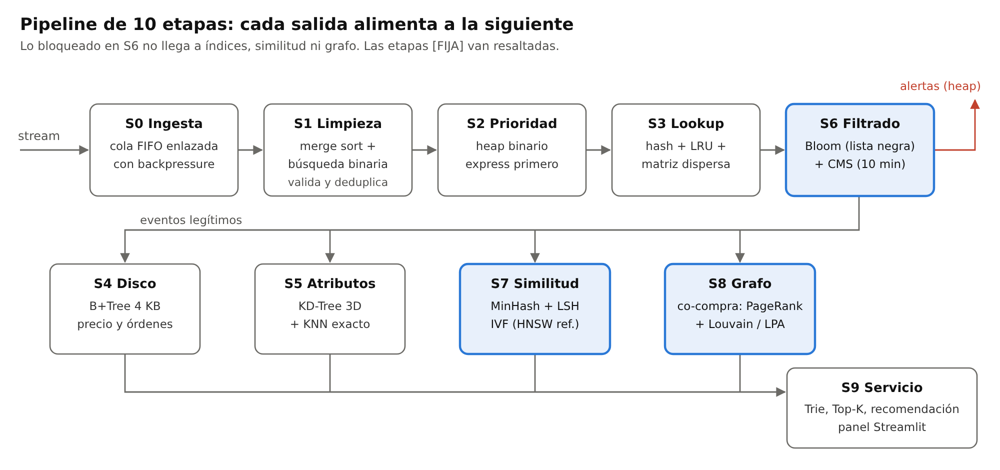

# Proyecto Final EDA 2026-2: pipeline de data streams para comercio electrónico

**UTEC · Maestría en Ciencia de Datos e IA · Estructuras de Datos y Algoritmos · Prof. Heider Sánchez**

Pipeline de 10 etapas que procesa un stream de eventos de una tienda en línea (escenario B) con estructuras de datos implementadas desde cero: cada etapa usa la estructura adecuada y su salida alimenta a la siguiente. Un evento entra por una cola FIFO, se limpia, se prioriza, se resuelve en tablas hash, pasa un filtro de fraude probabilístico y termina actualizando índices, similitud, el grafo de co-compra y el servicio de recomendaciones.



## Entregables

| Entregable | Dónde |
|---|---|
| Código fuente de las estructuras y el pipeline | [`src/eda/`](src/eda) |
| Informe PDF (8 a 12 páginas) | [`report/Proyecto_Final_GrupoEDA.pdf`](report/Proyecto_Final_GrupoEDA.pdf), fuente en [`report/informe.md`](report/informe.md) |
| Diapositivas | [`report/Presentacion_Final.pptx`](report/Presentacion_Final.pptx) |
| Notebook de análisis | [`notebooks/analisis_resultados.ipynb`](notebooks/analisis_resultados.ipynb) |
| Diagrama del pipeline | [`docs/pipeline.svg`](docs/pipeline.svg) |
| Resultados de experimentos (CSV) y figuras | [`results/bench/`](results/bench), [`report/figures/`](report/figures) |
| Resumen de la corrida con 10M eventos | [`results/demo/summary_10M.json`](results/demo/summary_10M.json) |

## Instalación y uso

Requiere Python 3.10 o superior.

```bash
pip install -r requirements.txt

# 1. Datos: stream sintético con el esquema de REES46 (o el dataset real, ver abajo)
python scripts/prepare_data.py --events 200000          # ~3 s
python scripts/prepare_data.py --events 10000000        # ~2 min, 10M eventos

# 2. Pipeline de punta a punta: imprime el recorrido de un evento por las 10 etapas
python scripts/run_pipeline.py --data data/synthetic_200000

# 3. Panel (etapa 9): demo en vivo, autocompletado, recomendaciones y rangos de precio
streamlit run src/eda/service/dashboard.py -- --data data/synthetic_200000

# 4. Pruebas (cada estructura contra su versión exacta) y experimentos
pytest
python bench/run_benchmarks.py --quick     # 1K a 100K, minutos
python bench/run_benchmarks.py             # 1K a 10M, horas en Python puro
python bench/plots.py                      # figuras log-log en report/figures/

# 5. Informe PDF (Markdown -> HTML -> PDF con Chrome/Chromium)
python scripts/build_report.py --group GrupoEDA
```

### Usar el dataset real REES46

1. Descargar *eCommerce behavior data from multi category store* de Kaggle en `data/raw/`:
   `kaggle datasets download -d mkechinov/ecommerce-behavior-data-from-multi-category-store -p data/raw --unzip`
2. `python scripts/prepare_data.py --source rees46 --events 10000000`

DuckDB lee los CSV en streaming y toma los primeros 10M eventos en orden temporal; el catálogo se deriva de los mismos eventos. Encima se agrega el componente sintético que el dataset no trae (dispositivo, tarjeta, tipo de envío, premium, consultas, duplicados y ráfagas de fraude) con semilla fija, como recomienda el enunciado.

## Arquitectura

| Etapa | Estructura (archivo) | Qué hace | Qué entrega |
|---|---|---|---|
| S0 Ingesta | Cola FIFO enlazada ([`linked_queue.py`](src/eda/structures/linked_queue.py)) | Buffer con capacidad entre el lector y el consumidor por lotes | Lotes de eventos |
| S1 Preprocesamiento | Merge sort + búsqueda binaria ([`sorting.py`](src/eda/structures/sorting.py)) | Valida, normaliza, elimina duplicados contra una ventana de 500K ids y ordena por tiempo | Eventos limpios |
| S2 Prioridad | Heap binario ([`heap.py`](src/eda/structures/heap.py)) | Compras express, premium, estándar, programadas, carritos, vistas | Eventos en orden de urgencia |
| S3 Almacenamiento | Tabla hash, LRU, matriz dispersa ([`hash_table.py`](src/eda/structures/hash_table.py), [`lru_cache.py`](src/eda/structures/lru_cache.py), [`sparse_matrix.py`](src/eda/structures/sparse_matrix.py)) | Catálogo y usuarios por id, caché de fichas y recomendaciones, matriz usuario × producto | Índices densos e interacciones |
| S4 Índice en disco | B+Tree de páginas de 4 KB ([`bplus_tree.py`](src/eda/structures/bplus_tree.py)) | Índice de precio (carga masiva) e índice temporal de órdenes (inserciones) | Consultas por rango |
| S5 Multidimensional | KD-Tree + KNN exacto ([`kd_tree.py`](src/eda/structures/kd_tree.py)) | Vecinos por precio, popularidad y conversión | Productos parecidos por atributos |
| S6 Filtrado [FIJA] | Bloom Filter + Count-Min Sketch ([`bloom_filter.py`](src/eda/structures/bloom_filter.py), [`count_min_sketch.py`](src/eda/structures/count_min_sketch.py)) | Lista negra (verificada contra el conjunto exacto) e intentos por tarjeta/dispositivo en 10 min | Alertas y eventos legítimos |
| S7 Similitud [FIJA] | MinHash + LSH, IVF, HNSW ([`minhash_lsh.py`](src/eda/structures/minhash_lsh.py), [`ann.py`](src/eda/structures/ann.py)) | Productos con compradores parecidos; vecinos en embeddings SVD | Productos relacionados |
| S8 Grafo [FIJA] | PageRank, Louvain, Label Propagation ([`graph.py`](src/eda/structures/graph.py)) | Grafo de co-compra por orden; influencia y comunidades | Ranking y comunidades |
| S9 Servicio | Trie, Top-K ([`trie.py`](src/eda/structures/trie.py)), panel ([`dashboard.py`](src/eda/service/dashboard.py)) | Autocompletado, más vendidos, recomendación combinada, alertas | Respuesta al usuario |

El orquestador está en [`src/eda/pipeline/`](src/eda/pipeline). S6 corre justo después de S3 para que lo bloqueado no contamine índices, similitud ni grafo. Las librerías externas (NetworkX, SciPy) solo se usan en los tests para validar resultados.

## Resultados principales

{{RESULTADOS_README}}

## Roles y contribución

Cada integrante es responsable principal de al menos dos etapas o una familia de algoritmos, la expone en la presentación y responde por ella en la sustentación.

| Integrante | Responsable principal de | Familias del bloque avanzado |
|---|---|---|
| Sebastian Rodrigo Garcia Villacorta | S0 Ingesta, S1 Preprocesamiento, S2 Prioridad, S9 Servicio y panel | — |
| Dante Guillermo Barreto Daza | S3 Almacenamiento (hash, LRU, matriz dispersa), S4 B+Tree, S5 KD-Tree | — |
| Clinton Michael Chulluncuy Reynoso | S6 Filtrado, S8 Grafo | Filtrado probabilístico, ranking de influencia, comunidades |
| Ronald Ramiro Hilario Orihuela | S7 Similitud, experimentos | Similitud de conjuntos, ANN vectorial |

La base del código se generó con asistencia de Claude Code (ver el historial de commits). Cada integrante revisa, prueba y amplía las etapas a su cargo en commits propios, de modo que el historial del repositorio refleje la contribución real de cada uno.

## Estructura del repositorio

```text
src/eda/structures/   estructuras de datos (una por archivo)
src/eda/data/         generador sintético con esquema REES46 y cargador del dataset real
src/eda/pipeline/     etapas y orquestador
src/eda/service/      panel Streamlit
scripts/              preparar datos, correr el pipeline, generar el informe
bench/                experimentos y figuras
tests/                pruebas unitarias e integración
notebooks/            análisis de resultados
report/               informe, figuras y diapositivas
results/              CSV de experimentos y resumen de la corrida de 10M
```
