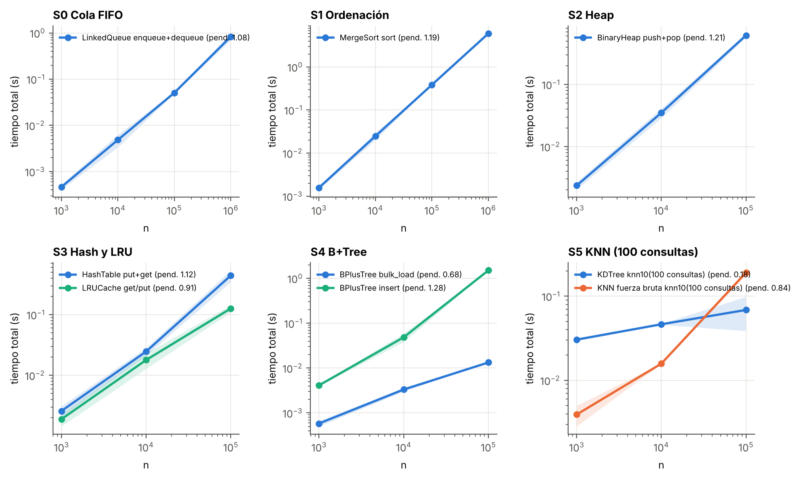
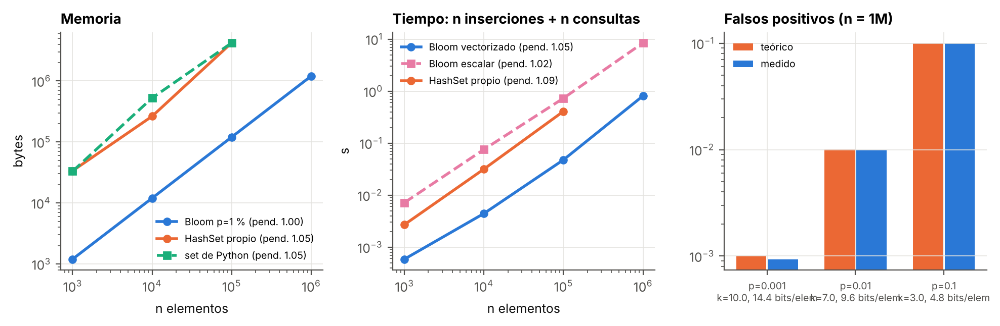
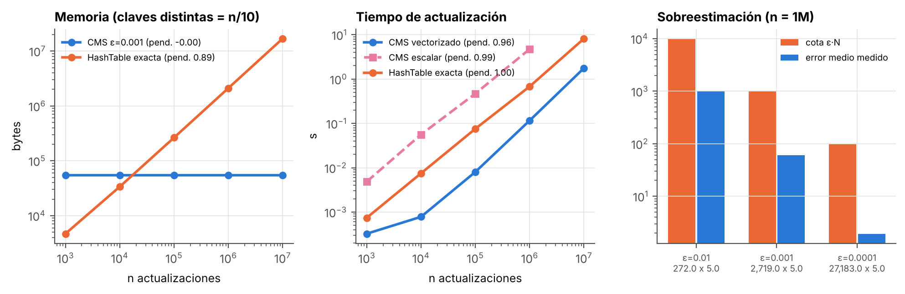
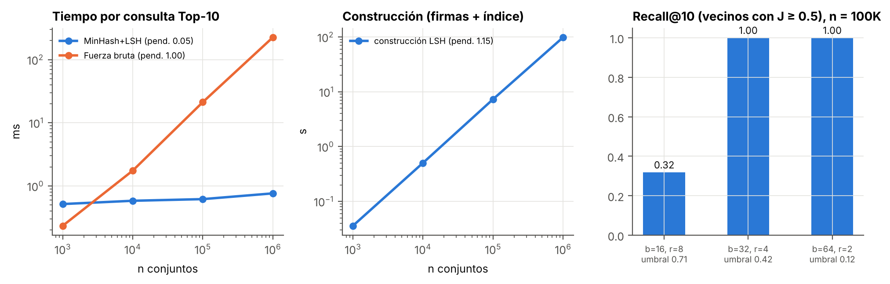
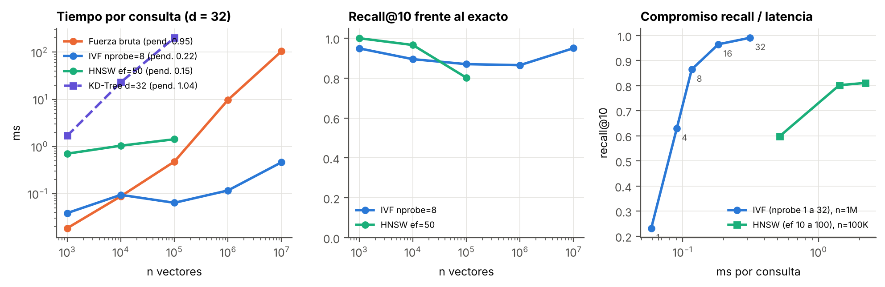
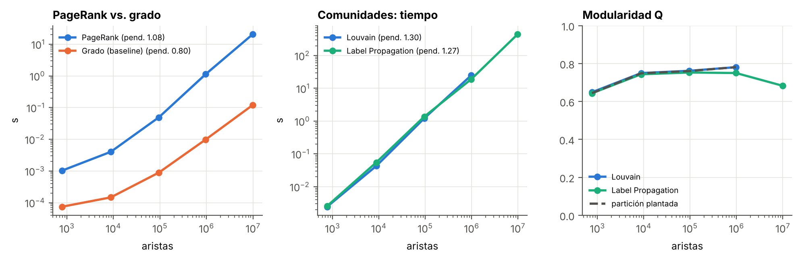
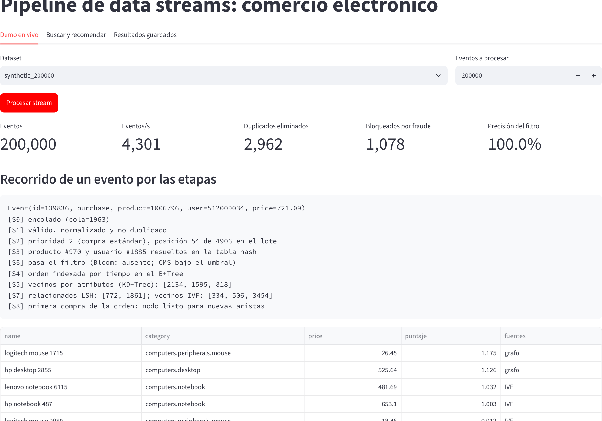

# Estructuras de Datos Avanzadas Orquestadas para un Pipeline Eficiente de Procesamiento de Data Streams

UTEC · Maestría en Ciencia de Datos e IA · Estructuras de Datos y Algoritmos 2026-2 · Prof. Heider Sánchez 
Integrantes: Sebastian Rodrigo Garcia Villacorta, Dante Guillermo Barreto Daza, Clinton Michael Chulluncuy Reynoso, Ronald Ramiro Hilario Orihuela 
Escenario B: comercio electrónico · Repositorio: github.com/dantebarreto-gif/Proyecto-Final-E-AD

## Resumen

Se construyó un pipeline de 10 etapas que procesa de punta a punta un stream de **10.222.591 eventos** de una tienda en línea (esquema REES46) a 7.402 eventos por segundo en Python, con todas las estructuras implementadas desde cero: cola FIFO enlazada, merge sort y búsqueda binaria, heap binario, tabla hash, caché LRU, matriz dispersa, B+Tree en disco, KD-Tree, Bloom Filter, Count-Min Sketch, MinHash + LSH, IVF y HNSW, PageRank, Louvain, Label Propagation y Trie. El filtro de fraude bloquea 64.923 eventos con precisión de 99,998 % y recall de 90,8 % usando 3,4 KB para la lista negra; el B+Tree responde una búsqueda sobre 10M claves en 44 µs con altura 3; el KD-Tree resuelve KNN 537 veces más rápido que fuerza bruta; LSH responde consultas de similitud hasta 295 veces más rápido que la comparación exhaustiva con recall@10 de 1,0 sobre los vecinos relevantes. Los experimentos de 1K a 10M confirman en escala log-log las complejidades teóricas. Un mismo evento queda trazado a través de las 10 etapas.

## 1. Contexto y objetivo

Una tienda en línea recibe un flujo continuo de vistas, carritos y compras. Sobre ese flujo hay que priorizar órdenes urgentes, consultar productos con baja latencia, detectar fraude en segundos, recomendar productos relacionados y descubrir qué productos se compran juntos. Cada problema tiene una estructura de datos adecuada; el objetivo del proyecto es encadenarlas de modo que la salida de cada etapa sea la entrada real de la siguiente, y medir cuánto ganan las estructuras aproximadas frente a sus alternativas exactas.

**Datos.** Se usa el esquema del dataset REES46 *eCommerce behavior data from multi category store* (Kaggle; ~285M eventos, columnas `event_time, event_type, product_id, category_id, category_code, brand, price, user_id, user_session`). El repositorio incluye el cargador del CSV real (DuckDB, lectura en streaming de los primeros N eventos ordenados por tiempo) y un generador con el mismo esquema y semilla fija que reproduce el embudo vista → carrito → compra, la popularidad Zipf de productos y sesiones centradas en grupos de categorías afines (lo que crea estructura de co-compra). Como pide el enunciado, el componente de stream es sintético en ambos casos: identificador de evento, dispositivo, IP, tarjeta, usuario premium, tipo de envío (express, estándar, programado), consultas de búsqueda, **1,5 % de duplicados** reenviados segundos después y **ráfagas de fraude** (25 a 120 intentos en menos de 5 minutos desde una tarjeta y un dispositivo). La mitad de las tarjetas fraudulentas se asume ya reportada (lista negra). Las corridas de este informe usan el generador porque el entorno de ejecución no tenía acceso a Kaggle; con los CSV en `data/raw/` el mismo comando corre sobre los datos reales.

## 2. Arquitectura del pipeline

<figure><figcaption>Figura 1. Flujo por lote. S6 se ejecuta inmediatamente después de S3: solo lo que pasa el filtro llega a S4, S5, S7 y S8, y todas las salidas convergen en S9.</figcaption></figure>

El stream se procesa en lotes de 5.000 eventos. Las etapas incrementales (S0 a S4, S6, S8 y S9) actúan sobre cada evento; las estructuras estáticas o costosas de construir (KD-Tree, firmas MinHash, SVD + IVF, PageRank y Louvain) se **refrescan** cada 2M eventos y al final, como en un sistema lambda con capa rápida y capa por lotes. Cada etapa deja una nota en la traza del evento, lo que permite verificar la integración de forma observable (sección 5).

## 3. Etapas 0 a 5: estructuras base

| Etapa | Estructura | Función en el pipeline | Complejidad | Alternativa descartada |
|---|---|---|---|---|
| 0 Ingesta | Cola FIFO con lista enlazada y capacidad máxima | Buffer entre el lector del stream y el consumidor por lotes; descarta y cuenta si se llena (backpressure) | enqueue/dequeue O(1) | Lista de Python: `pop(0)` es O(n) |
| 1 Preprocesamiento | Merge sort estable + búsqueda binaria vectorizada | Valida y normaliza; ordena el lote por id para eliminar duplicados adyacentes y busca cada id en la ventana ordenada de los últimos 500K ids; reordena por tiempo | O(b log b) por lote; O(b log W) contra la ventana | Conjunto de todos los ids: memoria sin límite |
| 2 Prioridad | Heap binario (min-heap) con desempate por llegada | Procesa primero compras express, luego premium, estándar, programadas, carritos y vistas; también ordena las alertas de fraude por severidad | push/pop O(log n), heapify O(n) | Lista ordenada: inserción O(n) |
| 3 Almacenamiento | Tabla hash con direccionamiento abierto (sondeo lineal, carga ≤ 0,7, lápidas), caché LRU (hash + lista doble), matriz dispersa DOK → CSR | Resuelve `product_id` y `user_id` a índices densos; cachea fichas y recomendaciones; acumula la matriz usuario × producto (vista 1, carrito 3, compra 5) | O(1) amortizado; CSR con nnz valores | Matriz densa: 200K × 200K floats no cabe |
| 4 Índice en disco | B+Tree con páginas de 4 KB (255 claves por hoja), hojas encadenadas y buffer pool LRU con write-back | Índice de precio del catálogo (carga masiva ordenada) e índice temporal de órdenes legítimas (inserciones); consultas por rango | búsqueda O(log_B n) páginas; rango O(log_B n + k/B) | Árbol binario: altura log₂ n y una página por nodo |
| 5 Multidimensional | KD-Tree (corte por mediana en el eje de mayor extensión, hojas de 16) y KNN exacto | Vecinos por atributos (log precio, log vistas, tasa de conversión) y consultas por caja | construcción O(n log n); KNN ≈ O(log n) en d bajo | Fuerza bruta O(n) por consulta (línea base) |

La clave del índice de precio combina precio en centavos e índice de producto (`precio·100 << 24 | id`), única y ordenada por precio. Con 10M claves el B+Tree tiene altura 3, así que una búsqueda lee como máximo 3 páginas.

## 4. Bloque de investigación avanzada (etapas 6 a 8)

### 4.1 Filtrado probabilístico: Bloom Filter y Count-Min Sketch

**Bloom Filter** (Bloom, 1970). Arreglo de *m* bits y *k* hashes: insertar pone *k* bits en 1; consultar responde "posiblemente presente" si los *k* están en 1. No hay falsos negativos y la tasa de falsos positivos es p ≈ (1 − e^(−kn/m))^k, mínima con m = −n ln p / (ln 2)² y k = (m/n) ln 2: para p = 1 % son 9,6 bits por elemento y k = 7, sin importar el tamaño de la clave. Las *k* posiciones se obtienen con doble hashing g_i = h₁ + i·h₂ mod m (Kirsch y Mitzenmacher, 2006) sobre splitmix64, y los bits van empaquetados en un arreglo `uint8`. Tiempo O(k) por operación. **Uso:** lista negra de tarjetas y dispositivos; como un positivo puede ser falso y bloquear una compra es una decisión crítica, todo positivo se verifica contra el conjunto exacto antes de bloquear. Límite: no admite borrado (sí con contadores, Counting Bloom) y la tasa de FP crece si se supera la capacidad.

**Count-Min Sketch** (Cormode y Muthukrishnan, 2005). Matriz de d × w contadores con un hash por fila; la estimación es el mínimo de las d celdas. Nunca subestima y, con w = ⌈e/ε⌉ y d = ⌈ln(1/δ)⌉, cumple f̂ ≤ f + εN con probabilidad 1 − δ. Memoria O(w·d) independiente del número de claves. **Uso:** clave = tarjeta y, por separado, dispositivo; **ventana** = 10 minutos en anillo de 10 sub-sketches de 1 minuto (al avanzar se limpia el más viejo); **umbral** = más de 12 intentos de compra o carrito por tarjeta, o 20 por dispositivo, en la ventana. La sobreestimación solo puede adelantar una alerta, nunca ocultarla.

### 4.2 Similitud de conjuntos: MinHash + LSH

Para una permutación aleatoria h, P[min h(A) = min h(B)] = J(A, B) (Broder, 1997): la fracción de coincidencias entre dos firmas de P minhashes estima Jaccard con error estándar √(J(1−J)/P). Con LSH por bandas (Indyk y Motwani, 1998) la firma se corta en b bandas de r filas y dos conjuntos son candidatos si coinciden en una banda completa: P[candidato] = 1 − (1 − J^r)^b, una curva en S con umbral ≈ (1/b)^(1/r). Se eligió MinHash (y no SimHash) porque el objeto natural es un **conjunto**: los usuarios que pusieron cada producto en el carrito o lo compraron. Con P = 128 y b = 32, r = 4, el umbral es 0,42. Las 32 bandas se indexan en **un solo arreglo ordenado** de pares (hash de banda mezclado con el número de banda, id), y una consulta son dos búsquedas binarias vectorizadas (la estructura de la etapa 1). Construcción O(P·nnz); consulta O(b log(nb) + candidatos).

### 4.3 ANN vectorial: IVF (y HNSW como referencia)

Los productos se representan con embeddings de 32 dimensiones obtenidos por **SVD truncada aleatorizada** (Halko et al., 2011) de la matriz usuario × producto en CSR, implementada solo con productos matriz-vector. **IVF** (índice de archivo invertido, Jégou et al., 2011): k-means (k-means++ y Lloyd) divide el espacio en nlist = 4√n celdas (máx. 4096); cada vector se guarda en la lista de su centroide y una consulta recorre solo las nprobe listas más cercanas: O(nlist·d + nprobe·(n/nlist)·d). **HNSW** (Malkov y Yashunin, 2020): grafo navegable en capas con nivel geométrico por nodo, descenso greedy en las capas altas y búsqueda best-first con ef candidatos en la capa 0, con la heurística de vecinos diversos del paper; O(log n) esperado. Se eligió IVF para el pipeline porque su construcción y consulta son operaciones de matriz (escala a 10M en Python), y HNSW se implementó para comparar el compromiso recall/latencia. La línea base es KNN exacto por fuerza bruta (O(n·d)); el KD-Tree de la etapa 5 sirve de contraste: en d = 32 deja de podar.

### 4.4 Ranking de influencia: PageRank

Grafo de co-compra no dirigido y ponderado: nodos = productos, peso(u, v) = número de órdenes (compras de una misma sesión) que contienen a ambos. PageRank (Brin y Page, 1998) es el vector estacionario de una caminata aleatoria que sigue aristas con probabilidad proporcional al peso y salta a un nodo aleatorio con probabilidad 1 − α (α = 0,85): r ← α(Pᵀr + masa colgante·v) + (1 − α)v. Se implementa con iteración de potencias sobre la CSR (O(m) por iteración, converge en norma L1 < 10⁻⁹) y se valida contra NetworkX. La versión personalizada (v concentrado en los productos del usuario) da recomendaciones locales. Línea base: grado ponderado. La diferencia es que PageRank premia estar conectado con productos a su vez centrales, no solo tener muchas co-compras.

### 4.5 Comunidades: Louvain frente a Label Propagation

**Louvain** (Blondel et al., 2008) maximiza la modularidad Q = Σ_c [L_c/2m − (d_c/2m)²] en dos fases repetidas: mover cada nodo a la comunidad vecina con mayor ganancia ΔQ ∝ k_i,c − Σ_tot·k_i/2m, y luego colapsar cada comunidad en un nodo. Casi O(m log n). **Label Propagation** (Raghavan et al., 2007): cada nodo adopta la etiqueta de mayor peso entre sus vecinos hasta que no hay cambios; casi lineal pero sin función objetivo, por lo que es menos estable. La estabilidad se mide con la información mutua normalizada (NMI) entre corridas con distinta semilla. Leiden (Traag et al., 2019) corrige comunidades mal conectadas de Louvain; queda como trabajo futuro.

## 5. Diseño de la integración

La integración se verifica con un evento concreto. En la corrida de 10M se trazó automáticamente una compra legítima ubicada al 70 % del stream; esta es su salida literal:

<pre>Event(id=7050005, purchase, product=1326857, user=512393910, price=132.88)
  [S0] encolado (cola=545)
  [S1] válido, normalizado y no duplicado
  [S2] prioridad 0 (compra express), posición 3 de 4917 en el lote
  [S3] producto #46693 y usuario #58009 resueltos en la tabla hash
  [S6] pasa el filtro (Bloom: ausente; CMS bajo el umbral)
  [S4] orden indexada por tiempo en el B+Tree
  [S5] vecinos por atributos (KD-Tree): [108810, 11894, 67409]
  [S7] relacionados LSH: []; vecinos IVF: [180133, 171512, 125502]
  [S8] co-compra con [143273, 99174, 32717] en la misma orden
  [S9] recomendaciones Top-5 para su producto:
       philips iron 2306                        puntaje=1.3    fuentes=grafo
       xiaomi vacuum 2827                       puntaje=1.102  fuentes=grafo
       samsung vacuum 1134                      puntaje=1.01   fuentes=grafo
       samsung vacuum 1737                      puntaje=1.0    fuentes=IVF
       philips iron 6859                        puntaje=0.9    fuentes=grafo</pre>

La compra es express, por eso sale tercera de 4.917 en el heap de su lote. LSH no devolvió candidatos para este producto porque ninguno supera el umbral de Jaccard (≈ 0,42) con su conjunto de compradores; la recomendación final se apoya entonces en el grafo de co-compra y en los vecinos IVF, y la fuente de cada producto queda registrada.

Cada flecha de la Figura 1 corresponde a un dato que la etapa siguiente consume: los índices densos de S3 son las filas y columnas de la matriz dispersa y los nodos del grafo; la matriz alimenta las firmas MinHash y la SVD de S7; las aristas de co-compra de S8 y su PageRank ponderan el ranking final de S9, que además usa los vecinos del KD-Tree (S5) y cachea el resultado en el LRU (S3). Las alertas de S6 se ordenan en un heap por severidad (lista negra antes que frecuencia) y la etiqueta de verdad (`is_fraud`, `is_duplicate`) se usa solo para medir, nunca para decidir. Hay 19 pruebas automáticas: cada estructura contra su versión exacta (dict, set, `numpy.searchsorted`, NetworkX para PageRank, fuerza bruta para KNN y Jaccard) y una prueba de integración que exige que el evento trazado pase por las etapas en el orden esperado.

## 6. Resultados experimentales

**Metodología.** Tamaños de 1K a 10M; 100 repeticiones para 1K y 10K, 10 para 100K, 3 para 1M y 1 para 10M (con 100 repeticiones, la serie de 10M habría tomado días en Python puro). Se reporta la media y la desviación estándar (banda sombreada en las figuras), el pico de memoria con `tracemalloc` y la pendiente en log-log como exponente empírico. Semilla fija 2026; máquina de 4 vCPU y 16 GB, Python 3.13 y NumPy 2.5 (`results/bench/platform.json`). Todos los CSV están en `results/bench/`.

### 6.1 Estructuras base

<figure><figcaption>Figura 2. Tiempo total frente a n (log-log), de 1K a 10M operaciones. La pendiente ajustada aparece en la leyenda.</figcaption></figure>

| Estructura (n = 10M) | Tiempo total | Por operación | Pendiente | Observación |
|---|---|---|---|---|
| Cola FIFO (enqueue + dequeue) | 13,7 s | 0,69 µs | 1,08 | Lineal, como se espera de O(1) por operación |
| Merge sort | 111 s | 11,1 µs | 1,19 | El factor log n eleva la pendiente sobre 1 |
| Heap binario (push + pop) | 181 s | 9,1 µs | 1,21 | Igual: O(n log n) en total |
| Tabla hash (put + get) | 47,9 s | 2,4 µs | 1,12 | 2,11 sondeos por operación con carga ≤ 0,7; 402 MB de pico |
| Caché LRU | 11,2 s | 1,1 µs | 0,91 | 91,5 % de aciertos con accesos Zipf |
| B+Tree: carga masiva / búsqueda | 2,0 s / 44 µs | | 0,68 / 0,45 | Altura 3, 43.862 páginas, 171 MB en disco |
| KD-Tree: KNN (k = 10) | 0,73 ms por consulta | | 0,18 | **537 veces** más rápido que fuerza bruta (393 ms) |

La búsqueda en el B+Tree crece de 26 µs a 44 µs entre 1M y 10M porque la altura pasa de 2 a 3 páginas; la inserción una a una (44 µs, pendiente 1,28) se midió hasta 1M y se omitió en 10M por tiempo (unos 7 minutos adicionales sin información nueva), porque el pipeline usa carga masiva para el índice de precio.

### 6.2 Filtrado probabilístico (S6)

<figure><figcaption>Figura 3. Bloom Filter frente a la tabla hash exacta propia y al set de Python: memoria, tiempo y tasa de falsos positivos teórica frente a medida.</figcaption></figure>

Con 10M elementos el Bloom (p = 1 %) ocupa **12 MB frente a 268 MB** de la tabla exacta (22 veces menos) y es 4,8 veces más rápido en inserción y consulta. La tasa medida de falsos positivos coincide con la teórica en los tres valores de p (0,0990 % frente a 0,1000 % con p = 0,1 %; 0,99 % frente a 1,00 %), y nunca hubo falsos negativos. La versión vectorizada con NumPy es 10 veces más rápida que la escalar con el mismo algoritmo.

<figure><figcaption>Figura 4. Count-Min Sketch frente a la tabla hash exacta: memoria, tiempo de actualización y error frente a la cota ε·N.</figcaption></figure>

Con 10M actualizaciones sobre 1M claves, el CMS con ε = 0,001 usa **53 KB frente a 16,8 MB** y actualiza 4,6 veces más rápido. El error medio (642) y el máximo (4.146) quedan bajo la cota ε·N = 9.997 en el 100 % de las claves, sin subestimar nunca; para las claves frecuentes, que son las que disparan alertas, el error relativo es 4 %. En el pipeline de 10M el filtro alcanza precisión de **99,998 %** y recall de **90,8 %**; los 10 falsos positivos del Bloom se descartaron en la verificación exacta. El recall no llega a 100 % porque los primeros intentos de cada ráfaga pasan antes de superar el umbral, que es el costo de no bloquear compras legítimas.

### 6.3 Similitud (S7)

<figure><figcaption>Figura 5. MinHash + LSH frente a Jaccard exacto por fuerza bruta: tiempo por consulta, construcción y recall según el número de bandas.</figcaption></figure>

La consulta LSH se mantiene en **0,6 a 0,8 ms** de 1K a 1M conjuntos (pendiente {{MH_SLOPE}}), mientras la fuerza bruta crece linealmente hasta 225 ms: **295 veces** más rápido en 1M, con recall@10 de 1,0 sobre los vecinos con J ≥ 0,5. Con 16 bandas (umbral 0,71) el recall cae a 0,32; con 64 bandas (umbral 0,13) se mantiene pero los candidatos por consulta pasan de 1,4 a 3,2, lo que confirma la curva en S. El costo está en la construcción (98 s para 1M) y la memoria de las firmas (1,5 GB = 128 × 12 B × 1M); por eso se omitió 10M (15 GB). En el pipeline las firmas se calculan solo para los 200K productos.

<figure><figcaption>Figura 6. ANN en d = 32: IVF y HNSW frente a KNN exacto y al KD-Tree; recall@10 y compromiso recall/latencia.</figcaption></figure>

{{ANN}}

### 6.4 Grafo (S8)

<figure><figcaption>Figura 7. PageRank frente al grado ponderado, y Louvain frente a Label Propagation en grafos con comunidades plantadas.</figcaption></figure>

PageRank escala linealmente en aristas (pendiente {{PR_SLOPE}}) y converge en 47 a 56 iteraciones: 20,7 s para 9,9M aristas. Su correlación de Spearman con el grado ponderado es 0,99 y el top-100 coincide en 97 %, así que en co-compra la diferencia está en la cola: PageRank sube productos conectados con productos centrales. {{COM}}

### 6.5 Pipeline completo con 10M eventos

| Etapa | Tiempo (s) | | Etapa | Tiempo (s) |
|---|---|---|---|---|
| S0 ingesta (lectura Parquet + cola) | 244 | | S4 B+Tree | 4,8 |
| S1 preprocesamiento | 64 | | S5 KD-Tree (consultas + 5 refrescos) | 4,4 |
| S2 prioridad | 78 | | S7 refresco LSH + SVD + IVF (5 veces) | 781 |
| S3 almacenamiento e interacciones | 81 | | S8 grafo (incremental + 5 refrescos) | 22,6 |
| S6 filtrado | 87 | | S9 servicio | 5,7 |

Total: 1.381 s (7.402 eventos/s) con 2,2 GB de memoria residente. Se eliminaron los 151.072 duplicados inyectados sin falsos positivos, se indexaron 254.328 órdenes en el B+Tree en disco (altura 3) y el grafo de co-compra quedó con 58.820 productos y 258.638 aristas. El refresco de S7 concentra el 57 % del tiempo (SVD y k-means sobre la matriz de 200K productos); refrescar con menor frecuencia o en paralelo es la mejora más directa. El panel Streamlit (Figura 8) expone la misma traza, las alertas ordenadas por el heap, el Top-K de ventas, el autocompletado con el Trie y las consultas por rango de precio sobre el B+Tree.

<figure><figcaption>Figura 8. Panel de la etapa 9 sobre el dataset de 200K eventos.</figcaption></figure>

## 7. Conclusiones

1. **La integración es real y observable.** Un evento atraviesa las 10 etapas y cada salida es la entrada de la siguiente: los índices de S3 son las filas del grafo y de la matriz, la matriz alimenta MinHash y la SVD, y el grafo, el IVF y el KD-Tree se combinan en la recomendación. Una prueba automática lo verifica en cada cambio.
2. **Las estructuras aproximadas ganan con error acotado.** Bloom y Count-Min reducen la memoria 22 y 300 veces con errores que coinciden con la teoría; LSH e IVF responden en milisegundos donde la búsqueda exacta es lineal. Donde un error es costoso (bloquear una compra), un paso exacto lo corrige.
3. **Las pendientes confirman la complejidad.** Lineal en la cola y la tabla hash, n log n en ordenación y heap, casi constante en la búsqueda del B+Tree y en el KNN del KD-Tree en baja dimensión, y lineal en todas las líneas base de fuerza bruta.
4. **Límites.** Python puro limita las repeticiones en 10M y deja fuera Louvain sobre 10M aristas y MinHash sobre 10M conjuntos; el KD-Tree pierde su ventaja en 32 dimensiones; y las corridas usan datos sintéticos con el esquema de REES46 por falta de acceso a Kaggle desde el entorno.
5. **Trabajo futuro.** Correr sobre REES46 real, paralelizar el refresco de S7, comparar Leiden con Louvain y usar Counting Bloom para permitir sacar tarjetas de la lista negra.

## Referencias

Bloom, B. H. (1970). Space/time trade-offs in hash coding with allowable errors. *Communications of the ACM*, 13(7), 422–426. https://doi.org/10.1145/362686.362692

Blondel, V. D., Guillaume, J.-L., Lambiotte, R., & Lefebvre, E. (2008). Fast unfolding of communities in large networks. *J. Stat. Mech.*, P10008. https://doi.org/10.1088/1742-5468/2008/10/P10008

Brin, S., & Page, L. (1998). The anatomy of a large-scale hypertextual Web search engine. *Computer Networks and ISDN Systems*, 30(1–7), 107–117. https://doi.org/10.1016/S0169-7552(98)00110-X

Broder, A. Z. (1997). On the resemblance and containment of documents. *Compression and Complexity of Sequences*, 21–29. https://doi.org/10.1109/SEQUEN.1997.666900

Cormode, G., & Muthukrishnan, S. (2005). An improved data stream summary: The Count-Min sketch and its applications. *Journal of Algorithms*, 55(1), 58–75. https://doi.org/10.1016/j.jalgor.2003.12.001

Halko, N., Martinsson, P. G., & Tropp, J. A. (2011). Finding structure with randomness: Probabilistic algorithms for constructing approximate matrix decompositions. *SIAM Review*, 53(2), 217–288.

Indyk, P., & Motwani, R. (1998). Approximate nearest neighbors: Towards removing the curse of dimensionality. *STOC '98*, 604–613. https://doi.org/10.1145/276698.276876

Jégou, H., Douze, M., & Schmid, C. (2011). Product quantization for nearest neighbor search. *IEEE TPAMI*, 33(1), 117–128. https://doi.org/10.1109/TPAMI.2010.57

Kirsch, A., & Mitzenmacher, M. (2006). Less hashing, same performance: Building a better Bloom filter. *ESA 2006*, 456–467.

Malkov, Y. A., & Yashunin, D. A. (2020). Efficient and robust approximate nearest neighbor search using hierarchical navigable small world graphs. *IEEE TPAMI*, 42(4), 824–836. https://doi.org/10.1109/TPAMI.2018.2889473

Raghavan, U. N., Albert, R., & Kumara, S. (2007). Near linear time algorithm to detect community structures in large-scale networks. *Physical Review E*, 76(3), 036106. https://doi.org/10.1103/PhysRevE.76.036106

Traag, V. A., Waltman, L., & van Eck, N. J. (2019). From Louvain to Leiden: Guaranteeing well-connected communities. *Scientific Reports*, 9, 5233. https://doi.org/10.1038/s41598-019-41695-z

Cormen, T. H., Leiserson, C. E., Rivest, R. L., & Stein, C. (2022). *Introduction to Algorithms* (4th ed.). MIT Press. · Leskovec, J., Rajaraman, A., & Ullman, J. D. (2020). *Mining of Massive Datasets* (3rd ed.). Cambridge University Press. · Samet, H. (2006). *Foundations of Multidimensional and Metric Data Structures*. Morgan Kaufmann.

